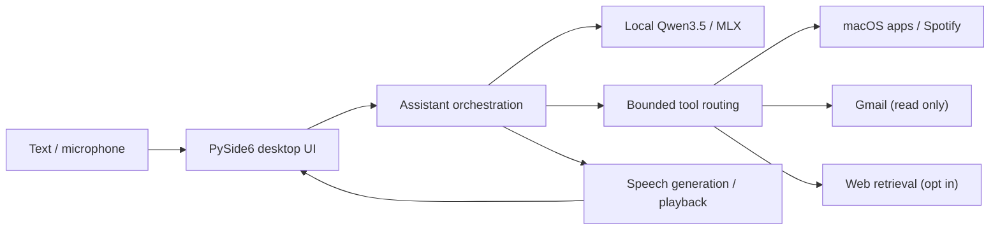

# Airis — a local-first AI desktop assistant

**A personal AI assistant for macOS, combining local language models, spoken conversations, and bounded actions across desktop applications.**

Airis is a work-in-progress software project, not a hosted service or a general-purpose autonomous agent. It explores what useful, privacy-conscious AI assistants can do when model inference happens on-device and tool access is explicitly constrained.

> **Project status:** Functional desktop prototype. Several integrations are implemented; wake-word recognition remains experimental and does **not** meet its acceptance criteria.

## What it can do

| Feature | Implementation |
| --- | --- |
| Local conversations | Quantized Qwen3.5 models via MLX on Apple Silicon, with session history |
| Speech interface | Push-to-talk, speech transcription, and streaming spoken replies |
| macOS actions | Open or switch applications and request full-screen mode, with verification |
| Spotify | Play, pause, or select tracks via the installed macOS application |
| Gmail | Explicitly connected, **read-only** access to unread mail and summaries |
| Web research | Opt-in search and page reading with bounded follow-up steps and sources |
| Experimental wake word | Synthetic-data training pipeline and optional “Airis” / “Hey Airis” detection |
| Desktop app | PySide6 interface, menu-bar integration, and text/voice workflows |

### Example interactions

- “Open Spotify and make it full screen.”
- “Pause the music.”
- “Summarize my latest three unread emails.” *(requires explicit Gmail authorization)*
- “What are the latest updates on this topic?” *(requires web access to be enabled)*

Airis implements **bounded tool use**, rather than unrestricted computer automation. An action is selected from a small interface, validated, executed, and checked. It does not run arbitrary shell commands generated by a language model.

## Architecture



Core parts of the repository:

- `assistant.py` — conversation coordination and opt-in action providers.
- `processing/` — local model inference, request routing, web and email processing.
- `actions/` — controlled macOS, Spotify, Gmail, and web tools.
- `input/` and `output/` — microphone input, transcription, voice output, streaming.
- `ui/` — macOS desktop interface and interaction lifecycle.
- `training/wakeword/` — reproducible synthetic wake-word experiments.
- `tests/` — unit and simulation tests for application and service boundaries.

## Run locally

**Target environment:** macOS on Apple Silicon, Python 3, and enough RAM/disk space for the selected local models. The development setup was designed around Apple Silicon; Windows/Linux and standalone distribution are not supported.

```bash
git clone https://github.com/WagnerNico/airis-showcase.git
cd Airis
python3 -m venv .venv
source .venv/bin/activate
python -m pip install -r requirements.txt
python -m ui.desktop
```

The first launch may download model weights and require model preparation. Some optional actions require macOS permissions or credentials. Gmail uses Google OAuth with the read-only scope; no access token is bundled with this repository.

**Voice assets:** Personal or third-party voice reference recordings are intentionally **not included** in the public-facing source tree. Voice-cloning features that expect those reference files require separately supplied recordings with appropriate permission. See [voice profile setup](output/voice_profiles/README.md).

**Launcher:** The Finder/Dock launcher is machine-specific and therefore not distributed. After local setup, generate it with `python -m ui.build_launcher` if desired.

## What has *not* been solved

- **Wake-word reliability:** synthetic-data experiments and verification logic exist, but the detector has not met its false-activation and recognition targets. Push-to-talk is the reliable default.
- **Portability:** dependencies and operating-system integrations target macOS/Apple Silicon; setup is not a one-click installer.
- **Model and action scope:** this is an assistant with constrained tools, not a general autonomous agent. Gmail is read-only, and desktop actions intentionally cover only specific app operations.
- **Distribution:** provider authorization, deployment, user documentation, and licensing would need additional work before a general release.

## Testing and development notes

The repository includes unit and simulation tests under `tests/`. Many tests use mocked service boundaries and are not a substitute for on-device integration testing.

```bash
python -m unittest discover -s tests
```

Environment-specific tests may require additional setup. The original, more detailed engineering notes are in [Development notes](docs/DEVELOPMENT_NOTES.md); wake-word methodology and limitations are in [training/wakeword/README.md](training/wakeword/README.md).

## Privacy and safety

- Inference can run locally, but **web search** and **Gmail access** communicate with external services when explicitly enabled.
- Email contents are treated as untrusted input and cannot trigger desktop actions.
- This project excludes personal audio samples, OAuth secrets, local model weights, and machine-specific launcher files from its intended public distribution.
- See [Security and publication notes](SECURITY.md) before redistributing or forking.

## Author

Personal project by [Nico Wagner](https://github.com/WagnerNico), built to explore practical agentic AI interfaces and local machine-learning inference.

*No open-source license has been selected for this showcase. Please contact the author regarding reuse.*
