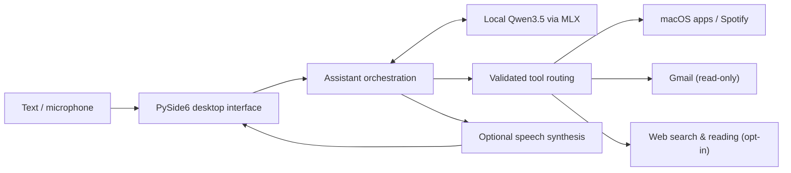

# Airis — Local-First Personal AI Assistant

**A macOS desktop assistant that combines locally running language models, voice interaction, and real-world tool use.**

Airis is a personal engineering project exploring how an AI assistant can move beyond chat: interpret a request, select a narrowly defined tool, interact with macOS applications, and report the result. Language-model inference runs locally on Apple Silicon via [MLX](https://github.com/ml-explore/mlx). Integrations such as web search and Gmail use external services only when enabled.

**Status:** Working research/development prototype, not a packaged end-user app. Text chat and supported desktop actions are the simplest ways to explore it; speech output requires additional local voice assets.

## Highlights

- **Local LLMs:** quantized Qwen3.5 4B and 9B models, model switching, conversation history, and prompt-cache reuse.
- **Agentic tool use:** a controlled request-to-action workflow with structured tool selection, action validation, execution, and result checking.
- **Desktop automation:** open or switch macOS apps and request full-screen mode; tools verify the resulting application state.
- **Spotify control:** play, pause, and select tracks through the installed Spotify desktop app.
- **Read-only Gmail:** summarize recent unread messages after explicit OAuth authorization; email cannot trigger desktop actions.
- **Web research:** optional search and page reading with bounded follow-up steps and source-aware responses.
- **Voice interface:** push-to-talk, local speech recognition, streaming speech synthesis, and selectable voice profiles (requires separately supplied reference audio).
- **Experimental wake word:** a synthetic-data training and evaluation pipeline for “Airis” / “Hey Airis”; recognition does *not* yet meet reliability targets.

### Example requests

> “Open Spotify and make it full screen.”  
> “Pause the music.”  
> “Summarize my latest three unread emails.”  
> “Find recent information about this topic.”

Some requests require the corresponding application, permission, or optional service connection. These are examples of supported workflows, not claims of unrestricted computer control.

## How it works



**Why the constrained tool design?** Airis does not execute arbitrary commands produced by an LLM. It routes supported requests to limited integrations and reports the outcome. Third-party content, including email messages, is handled as untrusted input.

| Component | Responsibility |
| --- | --- |
| [`assistant.py`](assistant.py) | Session orchestration and optional tools |
| [`processing/`](processing/) | Local model interface, intent routing, and grounded responses |
| [`actions/`](actions/) | Validated app, Spotify, Gmail, and web integrations |
| [`input/`](input/) | Microphone, transcription, and experimental wake-word inference |
| [`output/`](output/) | Speech generation, voice profiles, and playback |
| [`ui/`](ui/) | Desktop application and conversation workflows |
| [`training/wakeword/`](training/wakeword/) | Synthetic audio experiments and evaluation |
| [`tests/`](tests/) | Unit and integration-style simulation tests |

## Quick start: text chat on macOS

**Requirements:** macOS with Apple Silicon, Python 3, and sufficient RAM and storage for local model weights. Windows, Linux, and standalone app distribution are not supported by this setup.

```bash
git clone https://github.com/WagnerNico/personal-ai-assistant.git
cd personal-ai-assistant

python3 -m venv .venv
source .venv/bin/activate
python -m pip install -r requirements.txt

python -m ui.desktop
```

The first model launch can download weights and take time to initialize. The UI supports Qwen3.5 9B (default) and 4B (lighter option). Use **Text chat** first; a connected app is only necessary when testing its corresponding action. The commands above document the intended development setup, not a verified one-click clean install.

### Optional features and permissions

| Feature | Additional setup |
| --- | --- |
| Voice chat / spoken replies | Supply your own properly licensed or consented `reference.wav` for the selected voice profile. Files are deliberately excluded from the repository; see [voice profile setup](output/voice_profiles/README.md). Without reference audio, speech preparation will fail. |
| Gmail summaries | Connect a Google account explicitly using the Gmail **read-only** OAuth scope. No tokens or credentials are distributed. |
| App full-screen control | May require macOS Accessibility permission. |
| Spotify | Requires the installed, signed-in Spotify desktop app and macOS Automation permission when requested. |
| Web research | Enable web search and page reading in settings. |
| Wake-word listening | Requires separately generated local artifacts. This feature is experimental and disabled by default. |

For a Finder/Dock launcher on your own Mac, run `python -m ui.build_launcher` after setup. The launcher is machine-specific and is not tracked in this repository.

## Current limitations

- This is a **bounded desktop assistant**, not an open-ended autonomous agent or general computer-use system.
- Reference voice recordings, model weights, OAuth credentials, and machine-specific files are **not** bundled. A fresh clone does not provide working TTS without additional setup.
- The wake-word detector has not passed its accuracy/false-activation acceptance criteria; manual push-to-talk is the intended fallback.
- Some integrations require external services. Local inference should **not** be interpreted as complete offline operation.
- Tests cover many isolated behaviors, but a clean installation and every integration have not been independently verified for this showcase.

## Tests and further documentation

```bash
python -m unittest discover -s tests
```

Some tests require macOS services, model dependencies, or other environment-specific setup. See [development notes](docs/DEVELOPMENT_NOTES.md) and the [wake-word research notes](training/wakeword/README.md) for implementation details, experiments, and known limitations.

## Security and reuse

Please use test accounts and non-sensitive data when evaluating integrations. The repository intentionally omits personal voice samples and credentials. See [SECURITY.md](SECURITY.md) for release precautions and contact guidance.

**Author:** [Nico Wagner](https://github.com/WagnerNico)  
**License:** No open-source license has been granted for this personal showcase; contact the author before reusing or redistributing its code.
